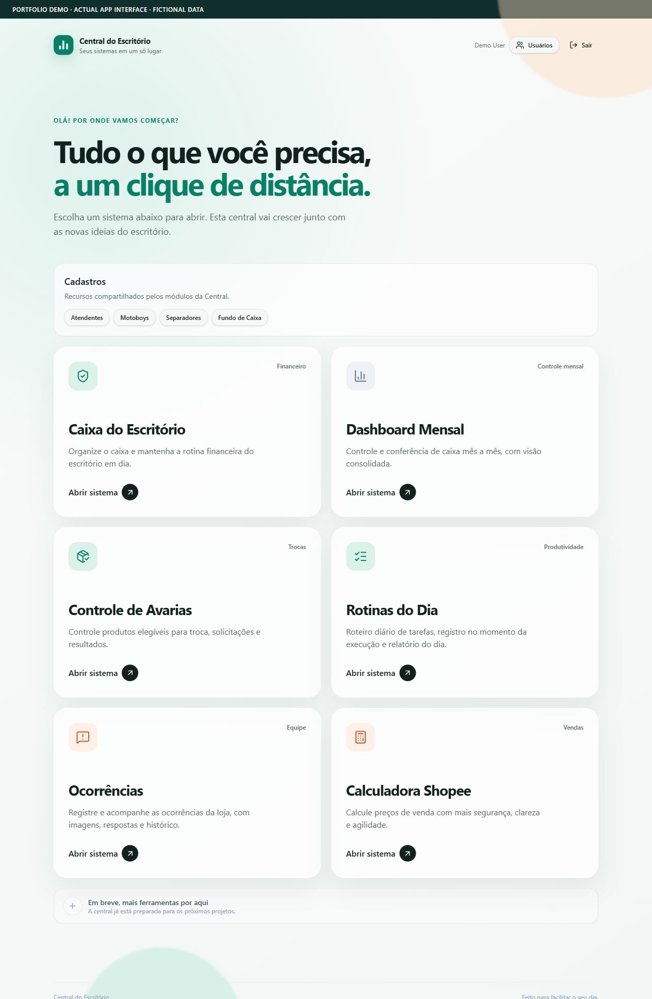
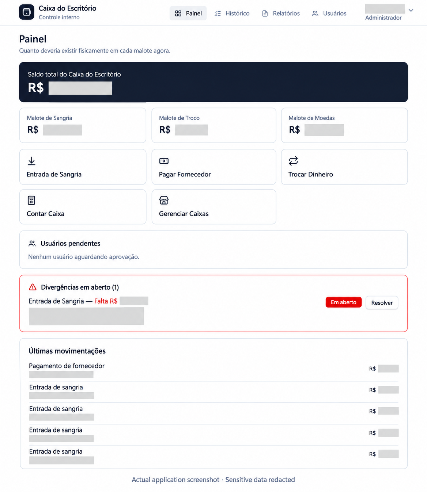
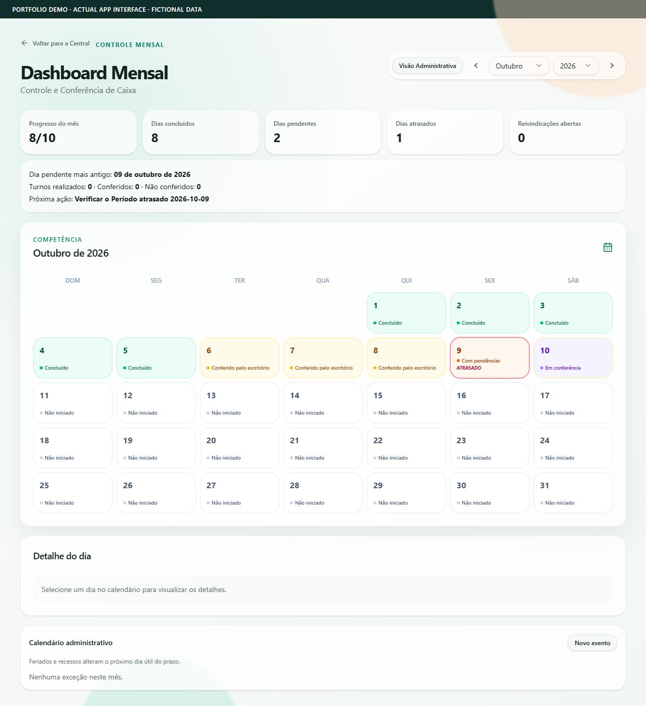
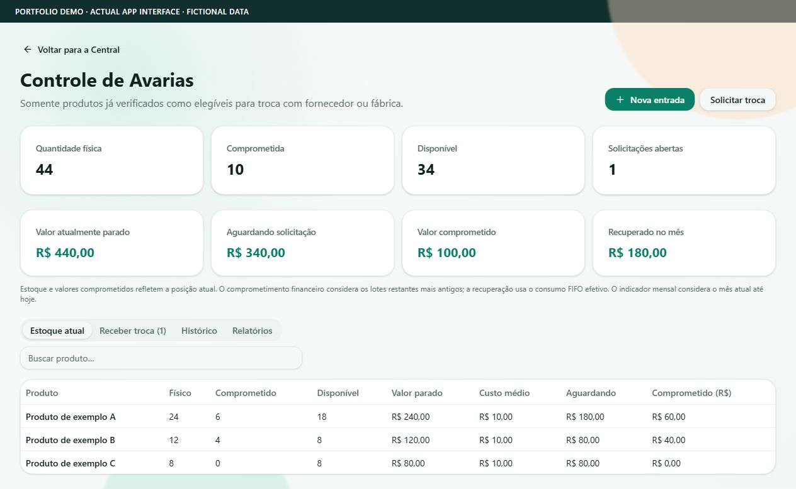
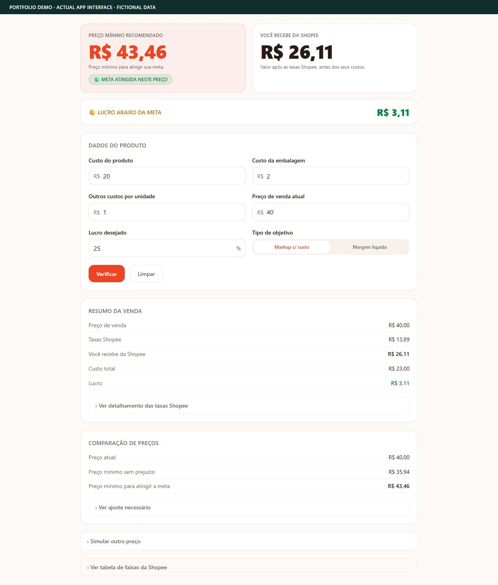
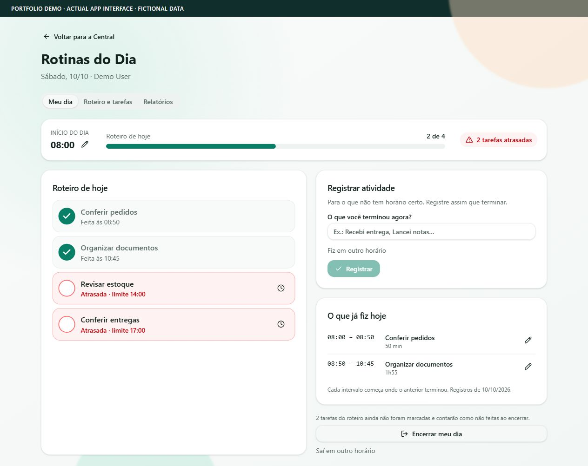
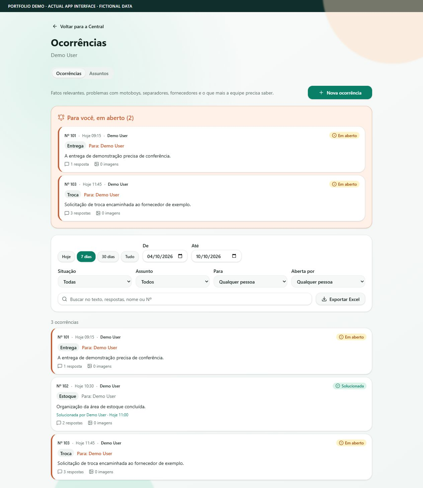

# Claudia Pessanha

### AI-Native Software Builder

**Business experience. Systems analysis. Software built through AI-guided implementation.**

I turn real operational problems into software by defining requirements, modeling workflows, guiding AI agents, and validating what they deliver. I have a background in Systems Analysis, previous experience in programming and teaching programming logic, and practical business experience as an entrepreneur.

My focus is the connection between a business need and a usable interface: clear rules, purposeful workflows, appropriate permissions, and careful functional testing.

**Seeking:** AI-Native Front-End Builder (Vibe Coder) opportunities.

[Contact me](mailto:claudiapessanha@gmail.com) · [GitHub](https://github.com/claudiapessanha)

---

## Selected work

| Project | Focus | Evidence reviewed |
| :--- | :--- | :--- |
| [Office Operations Hub](#01--office-operations-hub) | Internal workflows and module access | Code and documentation |
| [Office Cash Control](#02--office-cash-control) | Cash movements and audit workflows | Author account; screenshot; hub integration |
| [Monthly Dashboard](#03--monthly-dashboard) | Sales checking, shifts, and reconciliation | Code and documentation |
| [Damaged Goods Management](#04--damaged-goods-management) | Stock, replacement requests, and recovery | Code and documentation |
| [Shopee Profit Calculator](#05--shopee-profit-calculator) | Costs, fees, and pricing scenarios | Code and documentation |
| [Daily Routines](#06--daily-routines) | Recurring tasks and workday tracking | Code and documentation |
| [Operational Incidents](#07--operational-incidents) | Shared records and follow-up | Code and documentation |

The Operations Hub brings together internal modules and links to separate applications. The entries below describe distinct business workflows, rather than seven independent codebases. Implementation evidence does not establish that every project is publicly released or currently in production.

## 01 · Office Operations Hub

*Central do Escritório — internal operational management platform*

*Actual application interface, rendered locally from the app components with fictional demonstration data. The original interface language is Portuguese.*

**Problem.** Different operational workflows need a consistent entry point and controlled access for different responsibilities.

**Solution.** A responsive hub with authentication, user approval, role-aware navigation, and module-level access management.

**Verified capabilities**

- Module cards and navigation based on the user's access permissions.
- User status and role handling, including pending approvals.
- Restricted administration of module access.
- Protected routes for internal modules, with access checks beyond the navigation interface.
- Connections to separate Cash Control and Shopee applications.

**Verified technologies:** React, TypeScript, TanStack Start and Router, TanStack Query, Vite, Tailwind CSS, Radix UI, and Supabase authentication/data access.

**My role.** Conceived the platform, defined modules, profiles, authentication requirements, permissions, and operational rules. Guided AI-assisted implementation and personally validated functionality.

**AI-assisted workflow:** ChatGPT, ChatGPT Work, and Lovable, as reported from my development history. The repository also documents Lovable usage.

## 02 · Office Cash Control

*Caixa do Escritório — cash management and auditing*

*Author-provided application screenshot. Cropped and redacted with AI assistance to hide names, amounts, and operational details.*

**Problem.** Daily cash operations need consistent movement rules, clear reconciliation procedures, and traceability.

**Solution.** A separate application for cash control, transactions, and auditing, accessible through the Operations Hub.

**Scope reported from my project history**

- Cash movements, withdrawals, payments, and counts.
- Discrepancy handling and permission requirements.
- Audit workflows for operational accountability.

**Technology evidence:** The hub's external integration and the author-provided dashboard screenshot are verified. The Cash Control application's own source code was not available in the reviewed repositories, so its stack and implementation details are not asserted here.

**My role.** Defined the financial movement rules, permissions, and audit requirements. Personally tested the system and followed its rollout into real operations. Its operational use is reported from my own experience.

**AI-assisted workflow:** ChatGPT and Lovable, as reported from my development history.

## 03 · Monthly Dashboard

*Dashboard Mensal — sales checking and marketplace reconciliation*

*Actual application interface, rendered locally from the app components with fictional demonstration data. The original interface language is Portuguese.*

**Problem.** Sales checking requires more than monthly totals: operational days, shifts, payment information, and marketplace records must be reviewed together.

**Solution.** An internal dashboard that organizes operational periods, imports sales records, and supports checking and reconciliation workflows.

**Verified capabilities**

- Sales imports from XLS/XLSX reports, with pre-validation and import history.
- Operational days and shifts, including records that cross midnight.
- Preservation of imported source information and provenance.
- Marketplace reconciliation views and operational discrepancy handling.
- Shift checking and dedicated administrative views.

**Verified technologies:** React, TypeScript, TanStack Start and Router, TanStack Query, Tailwind CSS, Supabase/PostgreSQL, and SheetJS for spreadsheet processing.

**My role.** Specified sales checking, shift closing, import, reconciliation, discrepancy, and incident-handling requirements. Tested workflows privately with operational data, identified inconsistencies, and validated corrections.

**AI-assisted workflow:** ChatGPT, ChatGPT Work, and Lovable, as reported from my development history.

## 04 · Damaged Goods Management

*Controle de Avarias — damaged stock and replacement requests*

*Actual application interface, rendered locally from the app components with fictional demonstration data. The original interface language is Portuguese.*

**Problem.** Damaged stock must be tracked through requests and replacement outcomes while preserving quantities and historical costs.

**Solution.** An internal module that connects stock entries, supplier requests, replacement receipts, and recovery reporting.

**Verified capabilities**

- Product entries and physical, committed, and available stock balances.
- Supplier selection and requests containing multiple products.
- Partial replacement outcomes and request completion.
- Movement-based stock tracking and FIFO use of historical cost lots.
- Role-restricted financial reports and Excel exports.

**Verified technologies:** React, TypeScript, TanStack Query and Router, Tailwind CSS, Supabase/PostgreSQL, and database functions for transactional workflows.

**My role.** Defined eligibility, stock, request, receipt, balance, permission, and reporting requirements. Followed implementation, tested the workflows, and validated delivery.

**AI-assisted workflow:** ChatGPT and the AI implementation workflow used for the Operations Hub. A more specific tool attribution is not claimed.

## 05 · Shopee Profit Calculator

*Calculadora Shopee / Shopee Profit Suite — pricing decision support*

*Actual application interface, rendered locally from the app components with fictional demonstration data. The original interface language is Portuguese.*

**Problem.** Product cost alone does not show whether a marketplace selling price covers fees or meets a profitability target.

**Solution.** A calculator that combines costs with the configured fee model and compares pricing scenarios.

**Verified capabilities**

- Product, packaging, and other unit-cost inputs.
- Fee breakdowns and estimated profit or loss at a given selling price.
- Separate markup and net-margin targets.
- Break-even and minimum target-price calculations across configured fee tiers.
- Alternative-price simulation and warnings near fee-tier boundaries.

**Verified technologies:** React, TypeScript, TanStack Start and Router, Vite, Tailwind CSS, and Supabase integration in the reviewed suite.

**My role.** Defined the costs, fees, profitability calculations, and commercial rules. Guided iterative development and tested calculated results. Estimates depend on the configured assumptions; this portfolio makes no claim about current marketplace tariffs.

**AI-assisted workflow:** ChatGPT, ChatGPT Work, and Lovable, as reported from my development history. Lovable usage is also documented in the repository.

**Project scope.** The reviewed suite is a separate SaaS-oriented derivative of an internal calculator. Public release and live payment operation are not asserted.

## 06 · Daily Routines

*Rotinas do Dia — corporate tasks and recurring routines*

*Actual application interface, rendered locally from the app components with fictional demonstration data. The original interface language is Portuguese.*

**Problem.** End-of-day summaries can lose the timing and context of work. Recurring tasks also need explicit scheduling and follow-up.

**Solution.** An internal module for recording completed tasks throughout the day and comparing activity with each person's routine.

**Verified capabilities**

- Individual task lists and daily, weekly, and monthly recurrence rules.
- Optional deadlines and indicators for pending, late, or completed tasks.
- Workday start/end tracking and activity timelines.
- Controlled corrections with retained history.
- Administrative reports and Excel exports using the selected person and period.

**Verified technologies:** React, TypeScript, TanStack Query and Router, Tailwind CSS, and Supabase/PostgreSQL integration.

**My role.** Conceived the workflow, defined task and routine requirements, guided development, and personally validated the delivered functionality.

**AI-assisted workflow:** Claude and Claude Code, confirmed from my development history.

## 07 · Operational Incidents

*Ocorrências — incident recording and follow-up*

*Actual application interface, rendered locally from the app components with fictional demonstration data. The original interface language is Portuguese.*

**Problem.** Operational discussions in a messaging group can be difficult to retrieve and follow through to resolution.

**Solution.** An internal module with persistent incident records, replies, attachments, and resolution tracking.

**Verified capabilities**

- Incident subjects, explanatory text, image attachments, and replies.
- Recipient highlighting and subject-based automatic recipients.
- Resolution and reopening workflows.
- Filters and search for retrieving relevant records.
- Administrative audit history and filtered Excel export.

**Verified technologies:** React, TypeScript, TanStack Query and Router, Tailwind CSS, and Supabase/PostgreSQL with private image storage.

**My role.** Conceived the system, defined operational requirements, guided AI-assisted development, tested the workflows, and validated delivery.

**AI-assisted workflow:** Claude and Claude Code, confirmed from my development history.

---

## My development approach

1. **Understand the business.** Identify a concrete operational problem or opportunity.
2. **Specify the behavior.** Define objectives, rules, permissions, data meaning, and user flows.
3. **Guide implementation.** Use ChatGPT to structure requirements and technical instructions; use ChatGPT Work, Lovable, Claude, or Claude Code according to the project.
4. **Test personally.** Exercise workflows, identify inconsistencies, and request focused corrections.
5. **Validate delivery.** Check the implementation against the intended business behavior before making it available to users.

I do not present AI-generated implementation as code I wrote entirely by hand. My contribution is the analysis, product direction, business-rule definition, agent guidance, and functional validation that connect implementation to operational needs.

## Evidence and confidentiality

Descriptions were checked against the available private repositories and documentation on October 10, 2026. Tool usage and personal responsibilities are identified from my own development history. Office Cash Control has a narrower evidence basis, explicitly stated above.

This repository contains portfolio documentation and seven application screenshots. Six show the actual app components rendered locally with fictional data and an isolated demonstration data layer. The Cash Control image is an author-provided screenshot, cropped and redacted with AI assistance. No screenshots connect viewers to an internal system. No private application source code, unredacted business records, credentials, internal configuration, or production administration links are included. No measured business outcomes are claimed without supporting evidence.

## Let's connect

**Claudia Pessanha — AI-Native Software Builder**  
[claudiapessanha@gmail.com](mailto:claudiapessanha@gmail.com)  
[github.com/claudiapessanha](https://github.com/claudiapessanha)
